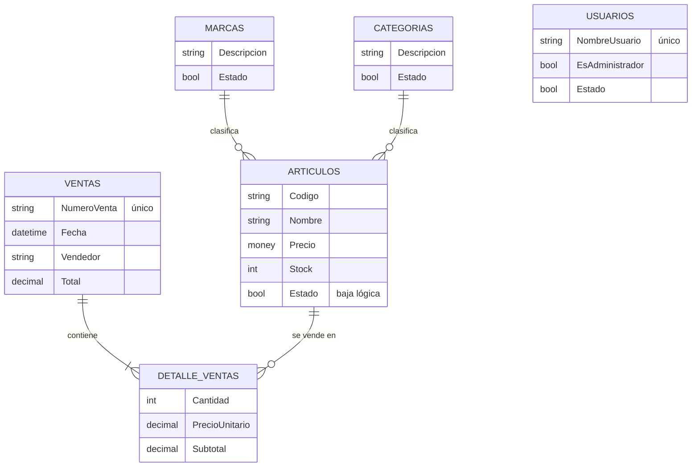

# SGC · Sistema de Gestión Comercial

Aplicación de escritorio para administrar el catálogo, el stock y las ventas de un comercio, con inicio de sesión por perfiles (administrador y vendedor) y reportes de inventario.

**Contexto:** primera versión del sistema. La versión actual es [SGC-Web](https://github.com/f-Rra/Gestion-Comercial-Web), la misma aplicación llevada a la web con ASP.NET WebForms.

## Stack

.NET Framework 4.8.1 · C# · Windows Forms · ADO.NET · SQL Server (procedimientos almacenados, vistas y triggers).

## Modelo de datos

El stock lo descuenta un trigger de la base al registrar cada línea de venta, y rechaza la venta si no alcanza. Otro trigger impide repetir el código de un artículo.

## Arquitectura

- **Presentación:** formularios de Windows Forms. Al iniciar sesión, el administrador entra a un panel con artículos, stock, categorías, marcas y reportes, y el vendedor va directo a las ventas.
- **Negocio y dominio:** una clase `*Negocio` por entidad, que accede a los datos a través de `AccesoDatos`, y entidades simples en `Dominio`.
- **Datos:** SQL Server. Las altas, bajas, modificaciones y ventas van por procedimientos almacenados, las lecturas usan vistas, y los valores viajan como parámetros.

## Qué cambió en la versión web

- **Del escritorio a la web.** Los formularios de Windows Forms pasaron a páginas WebForms con una Master Page y Bootstrap 5; las entidades, la base de datos y sus scripts SQL son los mismos.
- **Capa de negocio más ordenada.** El acceso a datos se libera con `using` en lugar de `try/catch` con `throw ex`, y el mapeo de filas a objetos está en un solo lugar.
- **Adaptado a la web.** El carrito y los filtros viven en la sesión, el login usa Forms Authentication y el reporte de inventario se exporta a PDF; en el escritorio se guardaba como imagen.

Está en [Gestion-Comercial-Web](https://github.com/f-Rra/Gestion-Comercial-Web).

## Autor

- Estudiante de la Tecnicatura Universitaria en Programación - UTN FRGP
- Email: [facundo.rra@gmail.com](mailto:facundo.rra@gmail.com)
